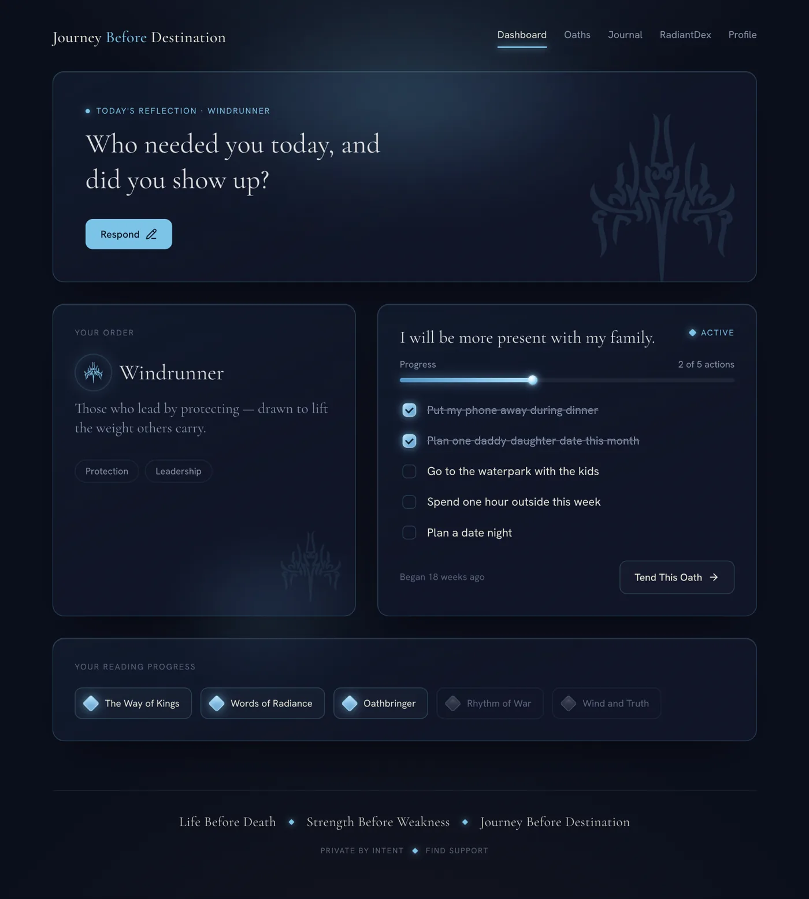
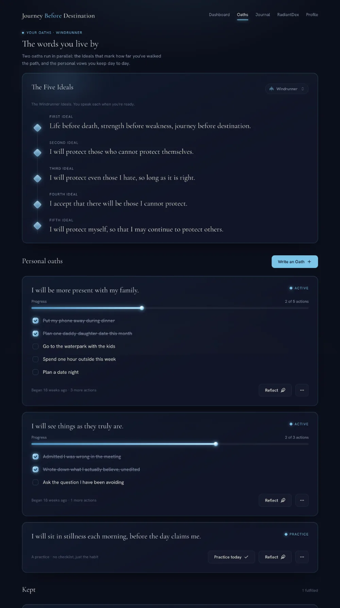
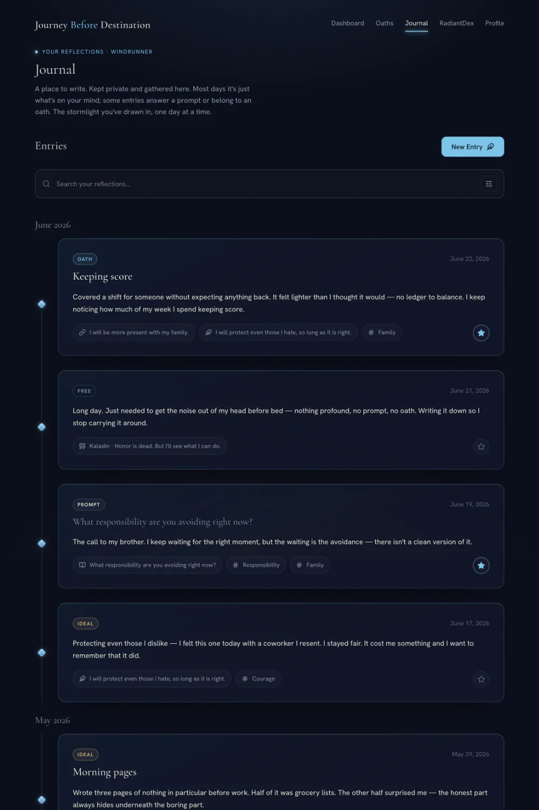
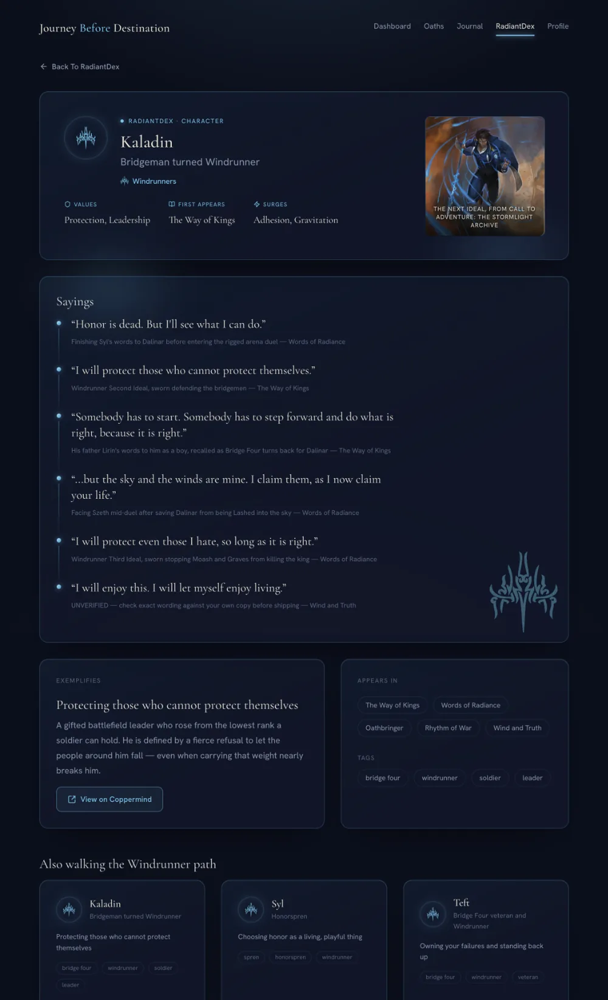
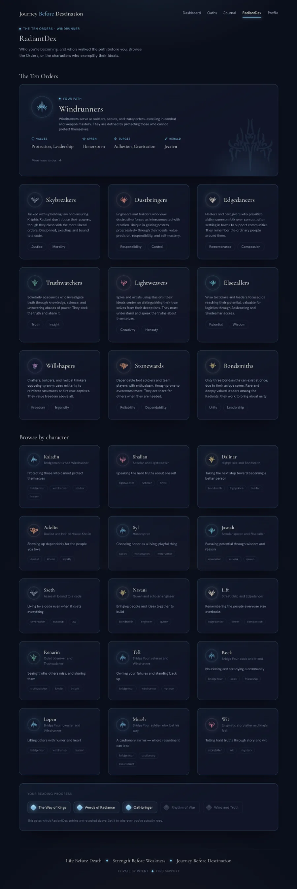

# Journey Before Destination

A Stormlight Archive–inspired companion app that helps readers turn the Ideals into real-life action.

The whole product serves one loop: **read a prompt → set an oath → take an action → reflect.** You pick a Radiant Order, swear a personal oath, break it into small actions, and journal about how it's going, with a light character reference (the RadiantDex) alongside for Stormlight flavor.

> Unofficial fan project. Not affiliated with or endorsed by Brandon Sanderson or Dragonsteel Entertainment. The Stormlight Archive and its characters belong to their respective owners.

## Application preview

A look at the current local-first build. These are representative development screens, not a hosted demo.

### Dashboard



### Oaths and journaling

| Oaths | Journal |
| --- | --- |
|  |  |

### RadiantDex



<details>
<summary>View the full RadiantDex directory</summary>



</details>

## What's in it

| Area | What it does |
| --- | --- |
| **Dashboard** | Today's prompt, your Order card, your active oath and its next actions, and reading progress through the books. |
| **Oaths** | Create and edit personal oaths, add and check off actions, archive finished ones. Each Order's Ideals form a ladder you can reveal, reflect on, or borrow from. |
| **Journal** | A feed of prompt responses, free-form entries, and reflections tied to your oaths. |
| **RadiantDex** | Character list and detail pages, Order detail pages, and links out to the Coppermind wiki. |
| **Profile** | Your identity card (Order, books read) and a summary of your progress. |
| **Onboarding** | *(in progress)* A short quiz that suggests an Order, plus book selection and an optional first oath. |

v1 is **local-first**: no accounts and no backend. Your data is a profile saved in the browser's `localStorage`.

## Product principles

A few rules settle most design decisions:

- **Reflection over productivity.** It's a companion, not a habit tracker.
- **Scaffold, then personalize.** You never start from a blank page. You get a Stormlight-derived starting point and make it your own, the way every Radiant swears the same words and means something personal by them.
- **Meaningful progression only.** Any progress marker is tied to a commitment you chose. No points, badges, or login streaks for their own sake.
- **Private by default** and **spoiler-aware.**
- **Tone:** reflective, calm, slightly epic. No hustle-culture motivation and no fake-therapy language.

## Tech stack

- [React 19](https://react.dev) (function components + hooks) with [Vite](https://vite.dev)
- [React Router](https://reactrouter.com) for pages
- State: a small `useLocalStorage` hook plus one `AppDataProvider` context (no Redux or Zustand)
- Styling: CSS Modules and CSS custom properties for a dark, Stormlight-themed palette, with self-hosted variable webfonts
- A hand-rolled, zero-dependency UI kit in [`app/src/components/ui/`](app/src/components/ui/) modeled on Ant Design's API
- JavaScript with JSDoc types (`// @ts-check`). A TypeScript conversion is planned for v1.1.

**Where it's headed:** the plan is to move the app to [Next.js](https://nextjs.org) with a real database and user accounts, replacing the current browser-only storage.

## Running it locally

The app lives in [`app/`](app/). From there:

```bash
npm install
npm run dev       # dev server with hot reload
npm run build     # production build to dist/
npm run preview   # serve the production build
npm run lint      # ESLint
```

## Repo layout

```
app/        The Vite + React app
Specs/      Product specs, research findings, and design handoffs
Media/      Order glyph SVGs and character art
```

The current build spec is [`Specs/Claude/JBD_SPEC_v3.md`](Specs/Claude/JBD_SPEC_v3.md), and the reasoning behind it is in [`JBD_RESEARCH_FINDINGS_v3.md`](Specs/Claude/JBD_RESEARCH_FINDINGS_v3.md).

## Roadmap

- **v1:** Dashboard, Oaths, Journal, minimal RadiantDex, Profile, Onboarding
- **v1.1:** RadiantDex search and filters, per-book spoiler gating, favorites, journal links to oaths and characters, Wit reflection prompts, TypeScript conversion
- **Later:** convert to Next.js with a database and real accounts

## About this project

This is also a learning build. I'm using it to move from class components and Create React App to modern React with hooks, Context, and routing, so the code favors clarity over cleverness.

**This app is not coded by AI.** It's hand-coded by a fan. AI helped with planning, the specs in [`Specs/`](Specs/), and acted as a tutor, but the app's code is written by hand.

*Life before death. Strength before weakness. Journey before destination.*

## License
All Rights Reserved. This project is publicly available for portfolio and review purposes only. Reuse, modification, or redistribution of the source code is not permitted without prior written authorization.
